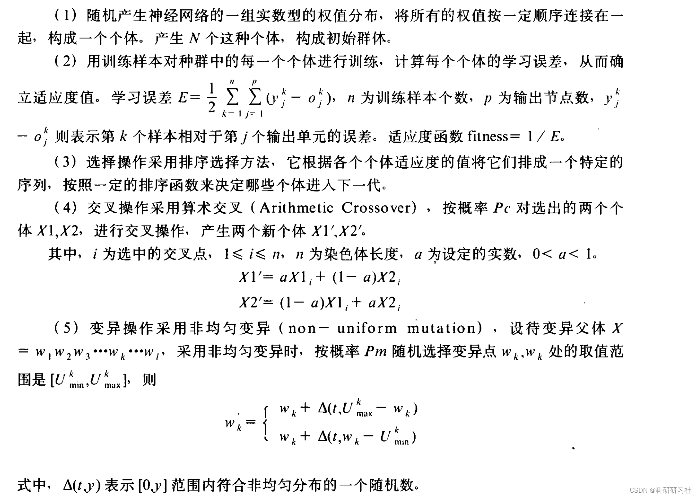
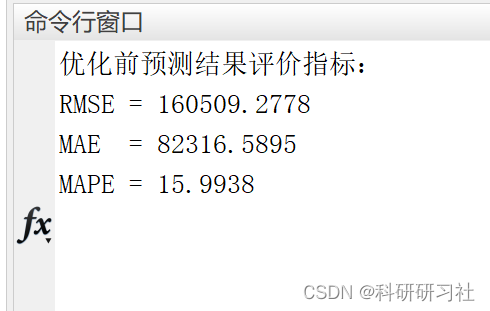
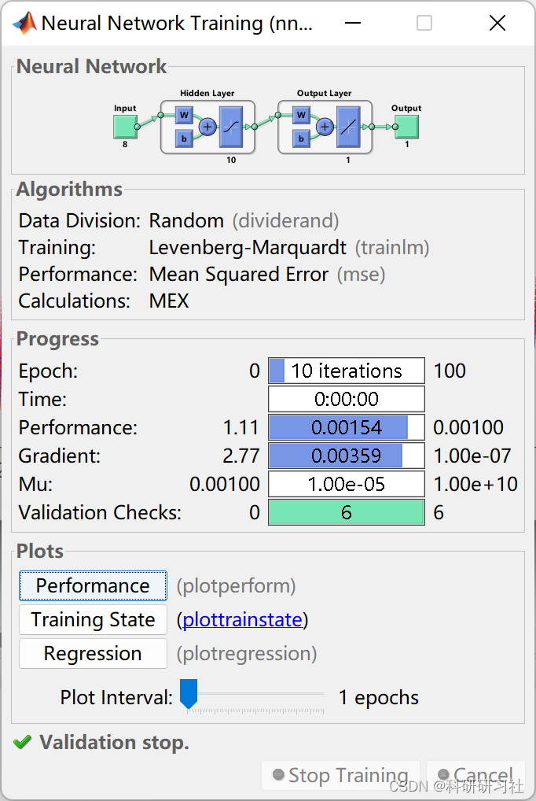
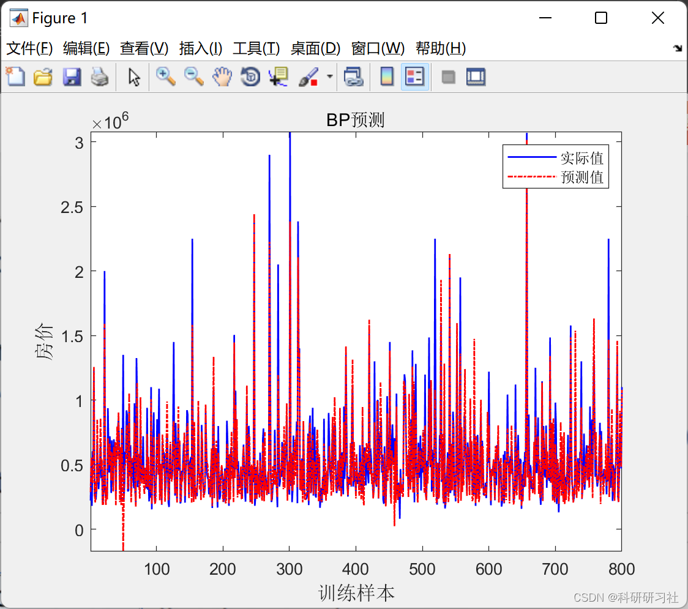
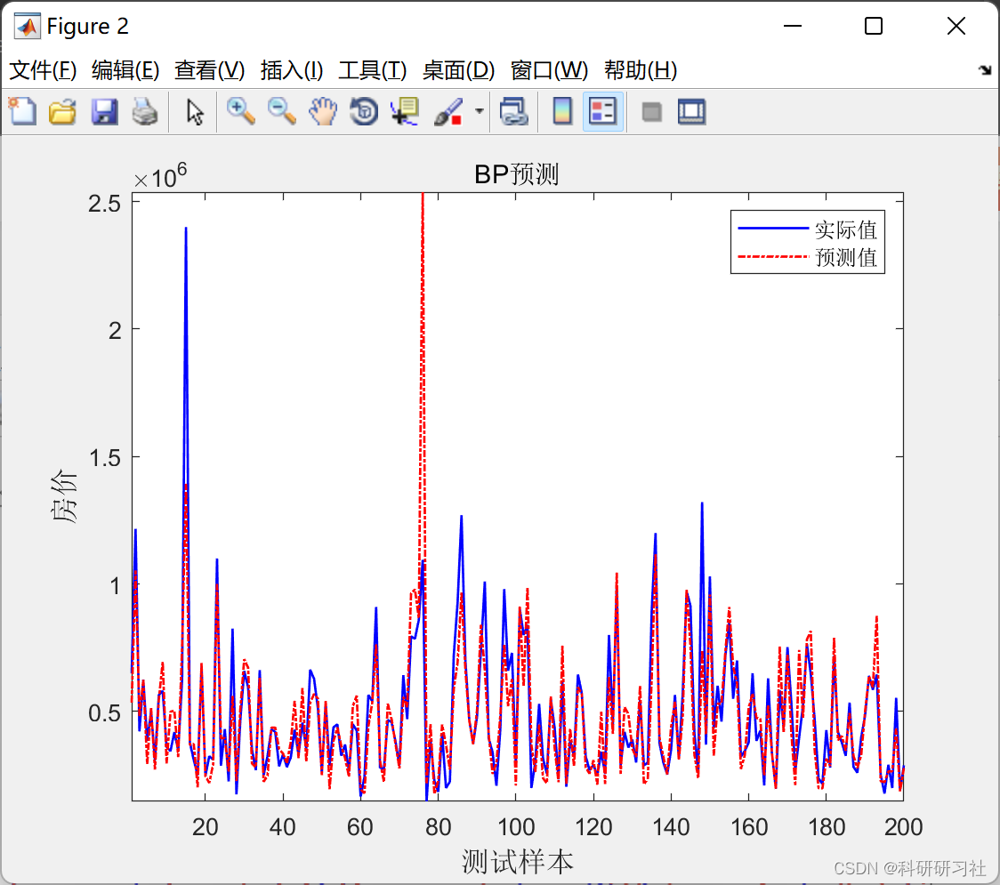
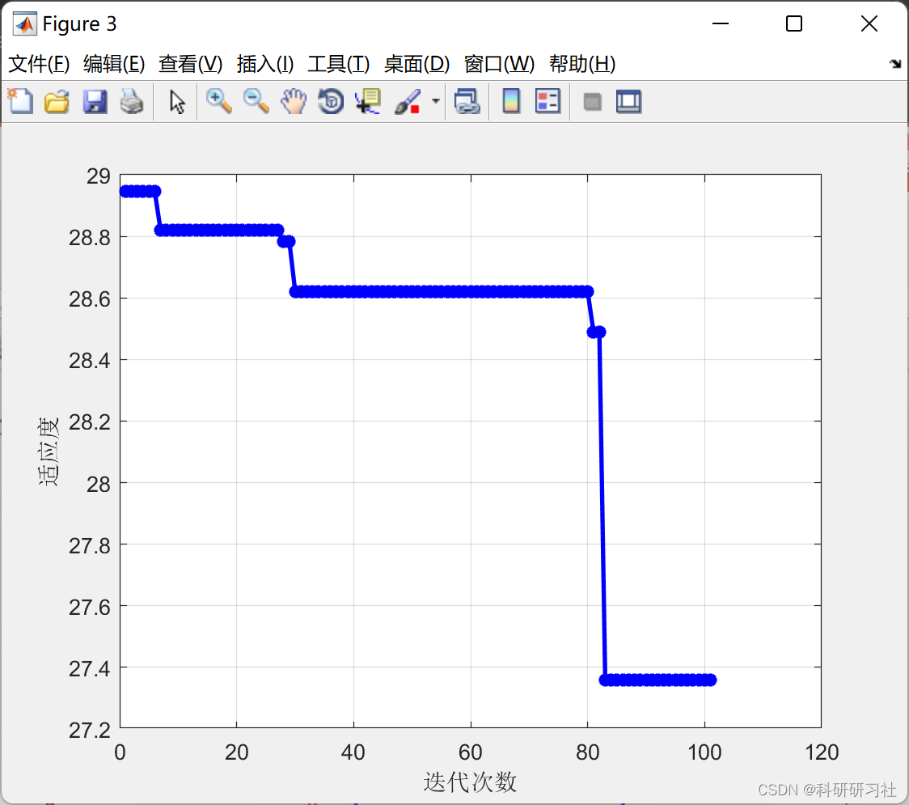
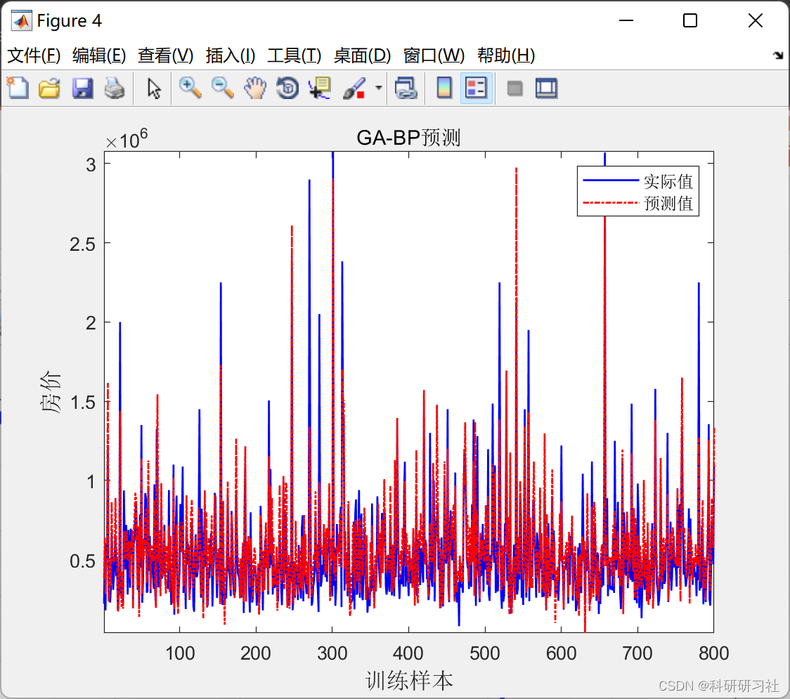
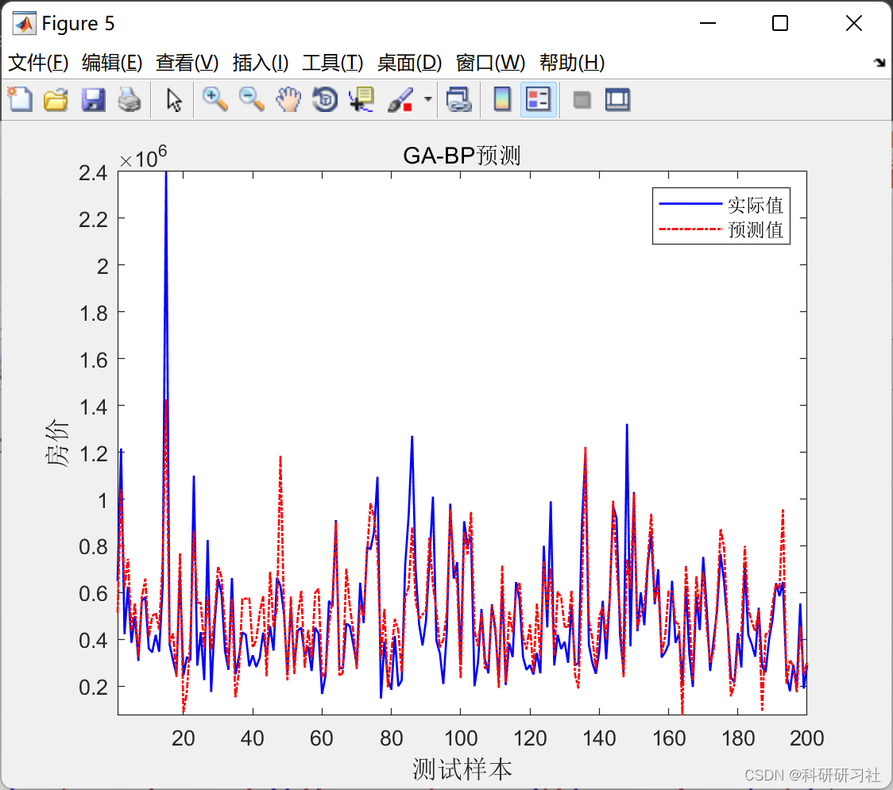

# Application of BP Neural Network Based on Genetic Algorithm in Exchange Rate Forecasting (Matlab Code Implementation)

Editor
1. Genetic Algorithms (GA)
1.1 Genetic Algorithms (GA) is a global optimization search algorithm that encodes the problem as chromosomes composed of genes, then simulates the natural evolution process to select, crossover, and mutate the chromosomes' fitness, producing chromosomes representing solutions through continuous loop processing. GA has strong robustness because it operates on chromosomes encoding the problem, isolating the characteristics of the problem itself, thus demonstrating broad adaptability. Additionally, since the algorithm starts operations from multiple initial points in parallel, it can prevent the search process from converging to local extremities.On the other hand, the use of crossover operators is different from blind search and fully random search. It is a process of constructing better solutions based on the current optimal solution, thus possessing certain advantages in terms of heuristic search and efficient gradient search. GA realizes the search process through a group, which differs from single-point search and is easy to parallelize, thereby enhancing the efficiency of the algorithm.
(2) General description of genetic algorithms. Firstly, determine the encoding form of chromosomes (i.e., individuals), establish the function to calculate the fitness value of chromosomes, determine parameters such as population size N, crossover rate Pc, mutation rate Pm, etc. Then programming can be carried out.
More detailed summary:  
Intelligent Optimization Algorithms - Genetic Algorithms (Python & Matlab implementation)  
2 Real-number coding of genetic algorithms combined with neural networks. Training a neural network using genetic algorithms can adopt binary or real-number coding. Considering the large scale of the neural network in this paper, we use real-number coding, the steps are as follows:
Edit  
(6) Repeat (3). (4). (5) until the next generation's population is full. Use GA to repeatedly optimize the weights of the neural network, calculate the fitness values of individuals in the current population, and obtain the individual with the highest fitness bestpop.
(7) Decode bestpop at this time, the parameter combination obtained is already close to the optimal parameter combination. On this basis, use the BP algorithm for learning to obtain the optimal weights of the network.
(8) Use the obtained optimal weights for simulation (prediction).
3 Matlab code and detailed article This only showcases part of the code, all codes and articles can be found in:  
Application Research on BP Neural Network Based on Genetic Algorithms in Exchange Rate Forecasting (Matlab Code Implementation)
function error = objfun_BP(x,inputnum,hiddennum,outputnum,net,inputn,outputn)\n%This function is used to calculate fitness values\n%x          input     individual\n%inputnum  input  number of input layer nodes\n%outputnum Input     Hidden layer nodes\n%net        input      network\n%inputn     input     Training input data\n%outputn    input      training output data\n\n%error Output individual fitness value\n\n% Extraction\nw1=x(1:inputnum*hiddennum);\nB1=x(inputnum*hiddennum+1:inputnum*hiddennum+hiddennum);\nw2=x(inputnum*hiddennum+hiddennum+1:inputnum*hiddennum+hiddennum+hiddennum*outputnum);\nB2=x(inputnum*hiddennum+hiddennum+hiddennum*outputnum+1:inputnum*hiddennum+hiddennum+hiddennum*outputnum+outputnum);\n\n\n% Network Evolution Parameters\nnet.trainParam.epochs=20;\nnet.trainParam.lr=0.1;\nnet.trainParam.mc = 0.8;% Momentum coefficient, between [0 1]\nnet.trainParam.goal=0.01;\nnet.trainParam.show=100;\nnet.trainParam.showWindow=0;\n \n% Network weight assignment\nnet.iw{1,1}=reshape(w1,hiddennum,inputnum);\nnet.lw{2,1}=reshape(w2,outputnum,hiddennum);\nnet.b{1}=reshape(B1,hiddennum,1);\nnet.b{2}=B2;\n\n% Network Training\nnet=train(net,inputn,outputn);\n\nan=sim(net,inputn);\nerror=sum(abs(an-outputn));\n  
4. Running Results Editing
Editor
Editor
Editor
Editor
Editor
Editor
​  

## Images

<!-- PAYMENT_BLOCK -->

## Get this dataset

- Payment link (Stripe): [Buy now](https://buy.stripe.com/3cs8yP7sY87d0vu9AB)
- Payment QR code: 

<!-- /PAYMENT_BLOCK -->
